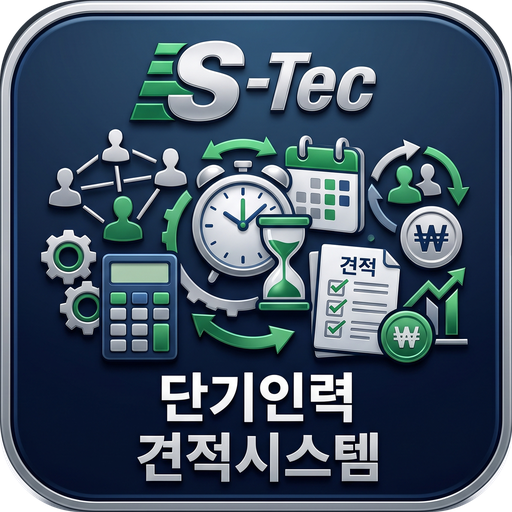

# S-Tec short estimate



**에스텍 단기인력 견적시스템** · v1.2.0

보안 · 미화 · 주차 · 시설 · 경호 · 소독 · 방역 · 방제 · 기타 단기 인력 견적을 근무시간과 시급만 넣으면 자동으로 산출합니다. 웹(HTML) 버전과 안드로이드 앱(APK)으로 씁니다.

## 내려받기

| 구분 | 파일 | 주소 |
|---|---|---|
| 웹 버전 | [index.html](index.html) | https://sadness500-boop.github.io/S-Ttec-short-estimate/ |
| 웹 버전 (버전별) | [releases/S-Tec_short_estimate_v1.2.0.html](releases/S-Tec_short_estimate_v1.2.0.html) | |
| 안드로이드 앱 | [releases/S-Tec_short_estimate_v1.2.0.apk](releases/S-Tec_short_estimate_v1.2.0.apk) | https://github.com/sadness500-boop/S-Ttec-short-estimate/raw/main/releases/S-Tec_short_estimate_v1.2.0.apk |

- **웹 버전 주소를 열려면** 저장소 Settings › Pages › Branch를 `main` / `/(root)` 로 한 번 켜야 합니다.
- **안드로이드 설치:** APK 내려받기 → "출처를 알 수 없는 앱 설치 허용" → 설치. Play 프로텍트 경고가 뜨면 "무시하고 설치".
- 앱 패키지명은 `kr.stecbest.shortestimate` 이며, 같은 서명 키로 만들어 새 버전을 지우지 않고 덮어 설치할 수 있습니다. 서명 키는 보안상 저장소에 올리지 않습니다(제작자 보관).
- HTML 한 파일에 영상·로고·Excel·QR 기능이 모두 들어 있어 인터넷 없이도 열립니다(글꼴만 온라인).

## 산출 방식

```
[ (근무시간 × 시급) + 각종수당(경호·미화·위험·주차·시설·교통비·식대·법정가산) ]
  × (1 + 4대보험 사업주 부담률) × (1 + 관리손익률 5% 이상) × 인원 × 일수
+ 장비·장구 대여비 (1일 단가 × 수량 × 근무일수, 관리손익 적용 선택)
```

- **비용 계산 기준:** 일반직(연장 50% · 야간 50% · 휴일 50%/8h 초과 100%) / 감시단속직(야간 50%만) / 기타(가산율 직접 입력)
- **4대보험 기본값 — 에스텍시스템 요율(2026, 1,000인 이상):** 국민연금 4.75% · 건강 3.595% · 장기요양 0.4724% · 고용 1.75% · 산재 0.92% = 11.4874%
- **최저임금:** 2026년 10,320원 · 2027년 10,700원 (근무일자 연도 기준 미달 경고)

## 장비 · 장구 대여 단가 (1일 기본값, 부가세 별도)

요율 설정 › 장비·장구 대여 단가표에서 수정할 수 있습니다. **시세** = 공개 가격 근거, **추정** = 판매가·장기렌탈료 환산값.

| 구분 | 장비·장구 | 1일 단가 | 근거 |
|---|---|---:|---|
| 통신·경호 | 업무용 무전기(이어셋) | 7,000 | 시세 (1일 1대 5,500~11,000원) |
| 통신·경호 | LTE 무전기 | 9,900 | 시세 |
| 통신·경호 | 휴대용 금속탐지기 | 10,000 | 추정 |
| 통신·경호 | 문형 금속탐지기(검색대) | 250,000 | 추정 (판매가 약 620만원) |
| 통신·경호 / 주차 | 차단봉 · 경광봉 · 라바콘 · 안전조끼 | 1,000~5,000 | 추정 |
| 미화 | 탑승식 바닥세척기 | 250,000 | 추정 (해외 일대여 $250~600) |
| 미화 | 보행식 바닥세척기 | 100,000 | 추정 |
| 미화 | 탑승식 건식 청소차(실외) | 150,000 | 추정 (국내 장기렌탈 월 36.5만원~) |
| 미화 | 공업용 청소기 | 40,000 | 시세 |
| 미화 | 고압세척기 전기식 / 엔진식 | 30,000 / 220,000 | 시세 |
| 시설·특수장비 | 지게차 일대(기사 포함) / 기본 40분 | 600,000 / 70,000 | 시세 (전국지게차연합회 표준임대료) |
| 시설·특수장비 | 사다리차 일대 / 반나절 | 500,000 / 350,000 | 시세 |
| 시설·특수장비 | 스카이차 1톤 일대 / 반나절 | 450,000 / 270,000 | 시세 |
| 시설·특수장비 | 고소작업대(시저리프트 6m) | 150,000 | 추정 (월 렌탈 30~45만원) |
| 소독·방역·방제 | 연무기·포그머신 / 초미립자 연무기(ULV) | 50,000 / 33,000 | 시세 |
| 소독·방역·방제 | 동력분무기 · 배부식 분무기 · 방역복 세트 · 약제 · 트랩 | 5,000~35,000 | 추정 |

## 주요 기능

1. 업종(보안·미화·주차·시설·경호·소독·방역·방제·기타)별 기본 시급·수당 프리셋, 비용 계산 기준별 법정가산 자동 계산
2. 업종별 추천 장비·장구 선택, 전체 장비 보기, 직접 추가, 단가·수량 수정
3. 견적서(금액 한글 표기 · 산출 근거 · 장비 내역) — Excel 저장, HTML 저장, 인쇄/PDF, 표 복사 (앱에서는 저장·공유 창)
4. 견적 담당 지정(미지정 시 잠금) · 다운로드 QR(웹·APK) · 친구 추천 · 주간/야간/시스템 화면
5. 메인화면: S-Tec 로고 4종 디자인, 영업 PT 영상 → 미화 · 보안 · 소독·방역·방제 · 주차 · 시설·특수장비 · 행사 경호 영상 순서 재생
6. 견적 보관함 (기기 저장)

## 변경 이력

- **v1.2.0** (2026-11-04) — 상단 S-Tec 글자 로고 삭제, S-Tec 로고 4종 디자인, 소독·방역·방제 업종, 장비·장구 대여비 28종(인터넷 시세 기본값), 영상 7편 순서 재생, GitHub 배포
- **v1.1.0** (2026-11-04) — 프로그램명·버전 표기, 견적 담당·다운로드 QR·친구 추천·테마, 메인 중앙 탭, 견적서 상호 "에스텍", 에스텍시스템 요율, 안드로이드 앱
- **v1.0.0** (2026-11-03) — 최초 버전

## 폴더 구성

```
index.html      웹 버전 (GitHub Pages 시작 화면, 최신 v1.2.0)
releases/       버전별 HTML · APK
icons/          앱 아이콘
version.json    현재 버전
```

---

*Designed & Developed by Rat Rae Choi*
